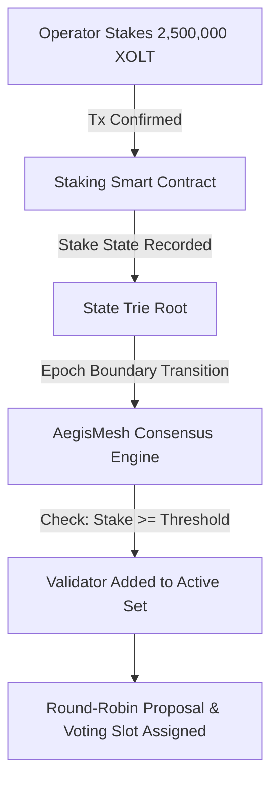

# Validator Node Setup & Staking Guide

This guide walks you through the complete process of operating a sovereign **Validator Node** on the XOLIX FLUID network.

---

## 1. Architecture & Security Model

A critical question many operators ask is:
> *"Does the network or explorer automatically generate and give validators their keys?"*

**The Answer: Absolutely NOT — and by design for maximum cryptographic security.**

In any decentralized, production-grade blockchain (including XOLIX FLUID, Ethereum, and Cosmos):
- **Private keys must NEVER be generated by a website, explorer, or central server.** If an explorer generated your keys over the internet, the server administrators or an attacker could access your private consensus key, double-sign blocks, and cause your entire stake to be **slashed (burned)**.
- **Sovereign Key Generation**: Your validator keys are generated **strictly locally on your own machine** (or within a Hardware Security Module / HSM) using the native cryptographic CLI.
- **Public Registration**: You submit only your **public consensus key** to the blockchain along with your stake. Your private key stays on your server, encrypted at rest, and is never transmitted over the network.

---

## 2. Hardware & Network Requirements

| Metric | Minimum (Testnet) | Recommended (Mainnet Production) |
| :--- | :--- | :--- |
| **CPU** | 4 Cores (x86_64 or ARM64) | 8 Cores (3.2+ GHz) |
| **RAM** | 16 GB ECC RAM | 32 GB ECC RAM |
| **Storage** | 500 GB NVMe SSD | 2 TB Enterprise NVMe SSD (PCIe 4.0) |
| **Network** | 100 Mbps symmetric | 1 Gbps symmetric unmetered |
| **OS** | Ubuntu 22.04 LTS / Debian 12 | Ubuntu 22.04 LTS / Debian 12 |
| **Open Ports** | `30303` (P2P Mesh TCP/UDP) | `30303` (P2P Mesh TCP/UDP) |

> [!WARNING]
> Do NOT expose port `8545` (HTTP RPC) or `8546` (WebSocket RPC) to the public internet on a validator node. Validator nodes should only expose port `30303` (P2P) to prevent Denial-of-Service (DoS) attacks.

---

## 3. Step-by-Step Validator Setup

### Step 1: Install the XOLIX Node Binary

```bash
# Clone the protocol repository
git clone https://github.com/emryvalyn/XOLIX-Block-FLUID-Infrastructure-.git
cd XOLIX-Block-FLUID-Infrastructure-

# Install dependencies and build node binary
npm install
npm run build
```

---

### Step 2: Generate Sovereign Validator Keys

Run the local key generator to create your consensus keypair and encrypted keystore:

```bash
# Generate consensus keypair locally on your validator machine
node dist/node/cli.js validator:keygen \
  --keystore /var/lib/xolix/keystore \
  --moniker "My-Validator-Node"
```

**Output:**
```
==================================================
        XOLIX FLUID VALIDATOR KEY GENERATION      
==================================================
Moniker:             My-Validator-Node
Consensus Algorithm: AegisMesh BFT (BLS12-381 / Ed25519)
Validator Address:   0x71C...49A
Public Consensus Key: 0x93a2f8b1c0...7894
Keystore Path:       /var/lib/xolix/keystore/validator.key (AES-256-GCM encrypted)
==================================================
IMPORTANT: Back up your mnemonic phrase securely offline.
NEVER share your validator.key file with anyone.
```

---

### Step 3: Configure the Node

Create the configuration file at `/var/lib/xolix/config.toml`:

```toml
[node]
moniker = "My-Validator-Node"
network = "mainnet" # or "testnet"
data_dir = "/var/lib/xolix/data"

[p2p]
listen_addr = "0.0.0.0:30303"
max_peers = 50
min_peers = 10
# Production Bootnodes
bootnodes = [
  "enode://xolix-seed1@seed1.xolix.io:30303",
  "enode://xolix-seed2@seed2.xolix.io:30303",
  "enode://xolix-seed3@seed3.xolix.io:30303"
]

[consensus]
validator_mode = true
keystore_path = "/var/lib/xolix/keystore/validator.key"

[metrics]
enabled = true
port = 9090
```

---

### Step 4: Sync the Blockchain

Before registering your stake, sync your node to the latest block height:

```bash
node dist/node/index.js --config /var/lib/xolix/config.toml
```

You will see:
```
[INFO] P2P: Connected to 18 peers via AegisMesh
[INFO] SYNC: Fast-syncing headers... Block #184,200 / #184,200 (100% Synced)
[INFO] CONSENSUS: Synced to state root 0x5a1b... Node is ready for validator activation.
```

---

### Step 5: Stake & Register Validator On-Chain

To become an active validator, you must stake the minimum threshold (e.g. **2,500,000 XOLT**) into the protocol's on-chain Staking Contract (`StakingPool` / `0x0000000000000000000000000000000000001001`).

You can stake via:
1. **The Block Explorer Staking Portal**: Visit `https://scan.xolix.io/staking`, connect your wallet, enter your validator's **Public Consensus Key** (from Step 2), and approve the deposit.
2. **The Command Line / SDK**:

```typescript
import { XolixWallet, XolixProvider, Contract } from '@xolix/sdk';

const STAKING_ABI = [
  "function registerValidator(bytes calldata consensusPubKey, uint256 commissionRate) external payable"
];

async function register() {
  const provider = new XolixProvider('https://rpc.xolix.io');
  const wallet = new XolixWallet(process.env.OPERATOR_PRIVATE_KEY!, provider);
  const staking = new Contract('0x0000000000000000000000000000000000001001', STAKING_ABI, wallet);

  const tx = await staking.registerValidator(
    "0x93a2f8b1c0...7894", // Your Public Consensus Key
    500,                    // 5.00% commission (basis points)
    { value: BigInt("2500000000000000000000000") } // 2,500,000 XOLT (18 decimals)
  );

  console.log(`Registration submitted: ${tx.hash}`);
  await tx.wait();
  console.log('Validator registered successfully!');
}
```

---

## 4. Does Activation Happen Automatically?

**Yes. The entire activation lifecycle is 100% autonomous and deterministic at the protocol level:**



1. **State Transition**: When your staking transaction confirms, your public key and staked balance are recorded in the state trie.
2. **Epoch Boundary**: Every epoch (e.g., 3,600 blocks), the AegisMesh consensus engine computes the new **Active Validator Set** dynamically from the state trie.
3. **Autonomous Admission**: If your stake meets or exceeds the threshold, the engine automatically adds your public consensus key into the active voting validator set.
4. **No Central Admin**: No administrator or governance multisig needs to click "approve". The state machine handles validator transitions deterministically.

---

## 5. Running as a 24/7 Systemd Service

Create `/etc/systemd/system/xolix-validator.service`:

```ini
[Unit]
Description=XOLIX FLUID Validator Node
After=network-online.target
Wants=network-online.target

[Service]
User=xolix
Group=xolix
Type=simple
WorkingDirectory=/var/lib/xolix
ExecStart=/usr/bin/node /opt/xolix/dist/node/index.js --config /var/lib/xolix/config.toml
Restart=always
RestartSec=5s
LimitNOFILE=65535
KillSignal=SIGINT
TimeoutStopSec=30s

[Install]
WantedBy=multi-user.target
```

Enable and start the service:
```bash
sudo systemctl daemon-reload
sudo systemctl enable xolix-validator
sudo systemctl start xolix-validator
sudo journalctl -u xolix-validator -f
```

---

## 6. Slashing Conditions & Penalties

To maintain Byzantine Fault Tolerance and prevent attacks, the protocol enforces strict slashing rules:

| Violation | Detection Method | Penalty | Consequence |
| :--- | :--- | :--- | :--- |
| **Double Signing (Equivocation)** | Two conflicting signatures signed at same height | **5% Stake Burned** | Permanent removal (Tombstoning) |
| **Downtime (> 500 consecutive missed blocks)** | Missed block signatures in round | **0.1% Stake Burned** | Jailed for 24 hours |
| **Invalid State Proposal** | Proposal containing invalid transactions/receipts | **10% Stake Burned** | Permanently banned |

> [!TIP]
> Never run two instances of your validator node with the same `validator.key` at the same time. Doing so will lead to double-signing and immediate slashing! Use an active-passive failover with remote signing or HSMs.
