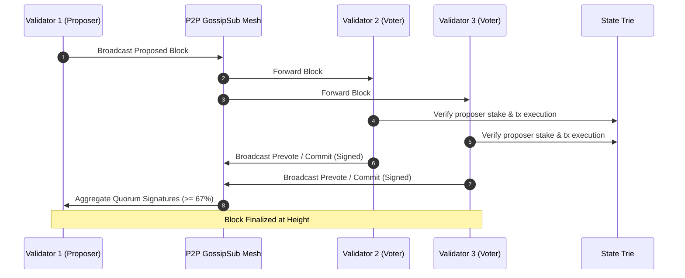

# P2P Mesh Networking & Peer Validation Architecture

> [!WARNING]
> **Status note**: This page describes the intended AegisMesh design. The P2P engine in the protocol repo (
ode/p2p/index.ts) implements handshakes, peers and scoring, but specific numeric values here (score deltas, ban durations, 3,600-block epochs, VRF shuffling) are illustrative and have not been verified against the code. Stake-based validator admission is not yet enforced by the node (see the Validator guide).

This document explains how the **XOLIX FLUID** peer-to-peer (P2P) networking layer (`AegisMesh v1.1.0`) connects nodes, validates peer authenticity, distinguishes real nodes from fake/sybil nodes, and guarantees Byzantine fault tolerance.

---

## 1. How Nodes Connect and Talk (AegisMesh P2P)

The XOLIX FLUID networking layer implements a high-throughput, low-latency authenticated P2P mesh network operating over TCP/UDP on port `30303`.

```
                    +--------------------+
                    |  Bootnodes / Seeds |
                    |  (seed1.xolix.io)  |
                    +---------+----------+
                              |
                 Handshake & Peer Exchange (PEX)
                              |
       +----------------------+----------------------+
       |                                             |
+------v-------------+                        +------v-------------+
|   Validator Node   |<======================>|   Validator Node   |
|     (Node Alpha)   |       Direct TCP       |     (Node Beta)    |
+------^-------------+     Encrypted Link     +------^-------------+
       |                                             |
       | GossipSub (Blocks & Txs)                    | GossipSub
       |                                             |
+------v-------------+                        +------v-------------+
|   RPC / Full Node  |<======================>|   RPC / Full Node  |
|    (Node Gamma)    |                        |    (Node Delta)    |
+--------------------+                        +--------------------+
```

### Discovery & Peer Exchange (PEX)
1. **Bootnode Discovery**: When a node launches, it contacts the hardcoded trusted bootnodes (`seed1.xolix.io`, `seed2.xolix.io`, etc.).
2. **Cryptographic Handshake**: Nodes exchange a secure `HANDSHAKE` payload containing:
   - Protocol version (e.g. `1.1.0`)
   - Network / Chain ID (`44990` for Mainnet, `44991` for Testnet)
   - Genesis Block Hash (`0x...`)
   - Node Peer ID and public key signature
3. **Peer Exchange (PEX)**: After a successful handshake, nodes exchange lists of known active peers (`PEER_EXCHANGE` messages), allowing the network to form a dense, decentralized mesh without relying on bootnodes once connected.
4. **Persistent Connections**: Each node maintains 30 to 100 simultaneous TCP connections across geographically distributed peers.

---

## 2. How Nodes Distinguish Real Nodes from Fake Nodes

In an open decentralized network, anyone can spin up a computer and try to send fake blocks or spam transactions. XOLIX FLUID employs **five layers of cryptographic and consensus verification** to ensure fake nodes cannot affect the network:

### Layer 1: Cryptographic Handshake & Chain Identification
When two nodes connect:
- If a peer's Genesis Hash does not match, the connection is **immediately aborted**.
- If a peer's Chain ID is different (e.g., testnet node trying to connect to mainnet), it is **dropped instantly**.
- Prevents cross-chain interference and incompatible network versions.

### Layer 2: On-Chain Stake Verification (Anti-Sybil)
Anyone can create 10,000 virtual nodes (a Sybil attack), but:
- **Voting Power Is Bound to On-Chain Stake**: A node can propose or vote on blocks **only if its public consensus key exists in the active validator set** recorded on the blockchain's state trie.
- Because joining the active validator set requires staking a minimum threshold (e.g., 2,500,000 XOLT), a Sybil attacker cannot create fake validators without locking up millions of actual tokens.

### Layer 3: Block Proposal Signature Verification
When a node receives a proposed block over the P2P GossipSub protocol:
1. It looks at the block header's `proposer_pubkey` and `proposer_signature`.
2. It queries the state trie:
   - *Is this proposer in the active validator set for the current epoch?*
   - *Is this proposer assigned to this exact slot/height in the round-robin schedule?*
3. If the proposer is NOT a registered validator or it is not their turn, the block is **instantly rejected**. It is never added to the chain and never propagated to other peers.

### Layer 4: BFT Quorum Finality ($\ge \frac{2}{3} + 1$ Signatures)
A block cannot be finalized by a single node alone:
- For a block to reach finality, $\ge \frac{2}{3} + 1$ of the total active staked weight must broadcast valid cryptographic signatures (commits) endorsing the block.
- A rogue or fake node cannot forge the cryptographic signatures of other validators.
- Even if up to $\frac{1}{3}$ of the validators are offline or malicious, the network remains Byzantine fault tolerant and continues operating securely.

### Layer 5: Peer Reputation Scoring & Automatic Banning
Every node locally tracks the behavior and reputation of all connected peers in memory (`AegisMesh PeerScorer`):

```typescript
// Conceptual logic inside node/p2p/index.ts
if (!isValidSignature(proposal) || !isStateValid(block)) {
  peer.reputationScore -= 30; // Heavy penalty for bad data
  if (peer.reputationScore < 20) {
    peer.isBanned = true;
    disconnect(peer, "MALICIOUS_OR_INVALID_DATA");
    firewallBlock(peer.ipAddress, 86400); // 24-hour IP ban
  }
}
```

- **Invalid Block Proposal**: Peer is penalized -30 points.
- **Invalid Transaction / Signature Spam**: Peer is penalized -10 points.
- **Malformed Protocol Packet**: Peer is penalized -20 points.
- **Threshold**: When a peer's score drops below 20, the connection is terminated and the peer IP is banned for 24 hours.

---

## 3. Block Propagation & Mempool Gossip

XOLIX FLUID uses GossipSub to disseminate data across the network in milliseconds:



1. **Transaction Broadcast**: When a user submits a transaction to any RPC node, the node verifies the signature and balance, then gossips it across the P2P mesh into all nodes' mempools.
2. **Block Proposal**: At the designated slot, the scheduled validator aggregates mempool transactions, executes them through the Fluid VM / EVM, signs the block header, and broadcasts the block.
3. **Validation & Voting**: Connected validators execute the transactions against their local state trie. If the state root matches, they sign a commit vote.
4. **Finality**: Once $\ge \frac{2}{3} + 1$ commits are gathered, the block is irreversibly finalized in 1 to 2 seconds.

---

## 4. Production Security Checklist for Operators

When running nodes in production:
- [x] **Strict Firewalling**: Ensure only port `30303` is open to the world. RPC ports (`8545`/`8546`) must be bound to `127.0.0.1` or behind an authenticated reverse proxy.
- [x] **DDoS Mitigation**: Run sentry nodes (proxy nodes) in front of your validator node so your validator's IP address remains hidden from the public network.
- [x] **NTP Time Synchronization**: Ensure `chrony` or `systemd-timesyncd` is active. Node clock drift must be $< 100\text{ms}$ for consensus slot alignment.
- [x] **SSD I/O Performance**: Ensure NVMe disks achieve at least 15,000 IOPS to keep pace with block execution without falling behind.
